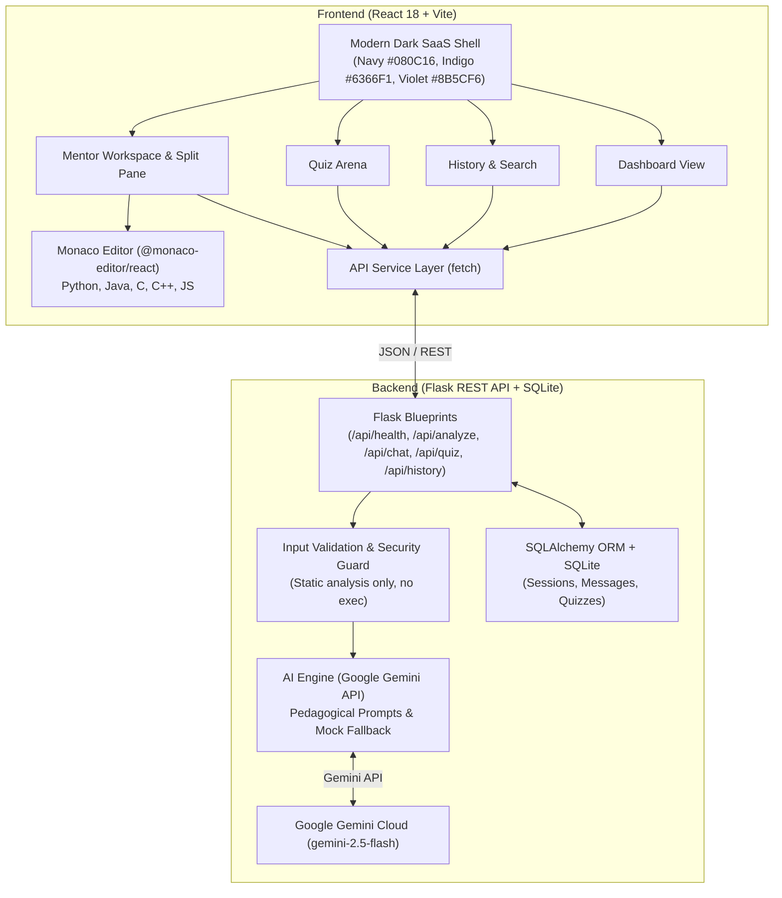

# AI Code Mentor 🚀
> An intelligent Generative AI programming tutor that helps students understand, debug, improve, analyze, and generate code, with interactive quizzes and contextual chat.


---

## 🌟 Key Features

### 1. 📊 Interactive Dashboard & Command Center
- **Welcome Analytics Banner:** Tracks total code sessions analyzed, quizzes completed, and average accuracy.
- **6 Quick-Launch Action Cards:** One-click shortcuts directly into the workspace pre-configured for the selected task and template.
- **Recent Activity Feed:** Displays past sessions with language pills, task tags, and one-click "Resume in Workspace".

### 2. 💻 Multi-Language Monaco Code Editor Workspace
- **VS Code Web Editor Engine (`@monaco-editor/react`):** Dark theme (`aiMentorDark`) matching the navy/charcoal SaaS aesthetic, with bracket pair colorization, line numbers, and minimap.
- **5 Supported Languages:** **Python**, **JavaScript**, **Java**, **C++**, and **C**.
- **Algorithmic Presets & Tooling:** One-click templates (Binary Search, Two Sum, Reverse Linked List, Kadane's Algorithm, Bubble Sort), document formatting, copy to clipboard, and clear editor.

### 3. 🔍 Line-by-Line Code Explanation
- Structured pedagogical breakdown associating specific lines and line ranges with targeted explanations.
- High-level overview, control flow analysis, variable mutations, and invariant walkthrough.

### 4. 🐛 Bug Detection & Debugging
- Detects syntax errors, logical bugs, and edge cases.
- Categorized severity badges (`High`, `Medium`, `Low`).
- Root cause explanation answering *why* the bug occurs.
- Corrected code with an **"Apply to Editor"** one-click action.

### 5. ⚡ Code Improvement & Optimization
- Algorithmic efficiency analysis (reducing loop overhead, optimal data structures).
- Readability and idiomatic code styling (PEP 8, clean variable names, modularity).
- Refactored code with before/after comparison.

### 6. 📊 Time & Space Complexity Analysis
- Rigorous Big-O calculation: Best Case, Average Case, and Worst Case Time Complexity (e.g. $O(n \log n)$, $O(n)$).
- Auxiliary Space and Total Space Complexity (e.g. $O(1)$ vs $O(n)$).
- Step-by-step mathematical derivation explaining loop bounds and recursion depth.

### 7. 💡 Natural Language Code Generation
- Dedicated requirement prompt input.
- Converts plain-English requests into production-ready, well-commented code in the target language.
- Includes step-by-step logic and example test runs.

### 8. 🧠 Dynamic Programming Quiz Arena
- AI-generated dynamic programming quizzes by Topic (Data Structures, Big-O, Recursion, Pointers, OOP, Async, Dynamic Programming), Language, and Difficulty (Beginner, Intermediate, Advanced).
- Interactive multiple-choice cards with instant validation.
- In-depth pedagogical explanations for why the correct answer is right and why distractors are wrong.
- Scorecard summary and retry options.

### 9. 🗄️ Persistent Chat & Analysis History (SQLite + SQLAlchemy)
- Persistent SQLite database (`mentor.db`) storing sessions, code snapshots, tasks, and quizzes.
- Search by keywords, filter by language or task, reload past sessions, or delete records.

### 10. 💬 Context-Aware Follow-Up Chat
- Retains conversational memory across dialogue turns.
- Aware of the active code in the Monaco editor and previous mentor explanations.
- Socratic tutoring mode that guides students through conceptual questions.

---

## 🛠️ Architecture & Tech Stack



| Layer | Technology | Details |
| :--- | :--- | :--- |
| **Frontend** | React 18, Vite | High performance, modular SPA |
| **Styling** | Modern CSS Variables | Charcoal/Deep Navy dark theme, glassmorphic surfaces, responsive grid |
| **Code Editor**| `@monaco-editor/react` | The VS Code web editor |
| **Backend** | Python 3.12, Flask, Flask-CORS | RESTful microframework |
| **Database** | SQLite + SQLAlchemy | Zero-config relational persistence |
| **AI SDK** | Google GenAI SDK (`google-genai>=1.0.0`) | Google Gemini Developer API integration with structured prompts |
| **Testing** | `pytest` | 100% test coverage across all REST endpoints |

---

## 🔒 Security Principles

1. **Zero Server-Side Code Execution:** User code is treated strictly as untrusted text. It is passed only to static parsers and AI prompts—never executed via `exec()`, `eval()`, or child subprocesses.
2. **Secret Protection:** `GEMINI_API_KEY` is kept exclusively on the server in `backend/.env`. It is never delivered to the client bundle.
3. **Graceful Fallback:** If `GEMINI_API_KEY` is not provided, the built-in mock service supplies realistic pedagogical responses, allowing the app to run completely offline without crashing.

---

## 🚀 Quick Setup & Run Instructions

### Prerequisites
- **Python 3.10+** (tested on Python 3.12)
- **Node.js 18+** (tested on Node.js 24)
- **npm** or **pnpm**

---

### Step 1: Clone or Navigate to the Workspace
```powershell
cd c:\Users\jyoth\OneDrive\Desktop\AI-Code-Mentor
```

---

### Step 2: Configure Environment Variables
Copy `.env.example` in `backend/`:
```powershell
copy backend\.env.example backend\.env
```
Open `backend/.env` and optionally set your Gemini API key:
```ini
GEMINI_API_KEY=your_gemini_api_key_here
GEMINI_MODEL=gemini-2.5-flash
PORT=5000
HOST=127.0.0.1
```
*(Note: If left blank, the app runs in **Offline / Mock Mode** with high-quality sample responses).*

---

### Step 3: Start the Backend Server
```powershell
# In terminal 1:
cd backend
python run.py
```
Backend starts on: **`http://127.0.0.1:5000`**

---

### Step 4: Start the Frontend Application
```powershell
# In terminal 2:
cd frontend
npm run dev
```
Frontend starts on: **`http://localhost:5173`**

---

### Optional: Run with Convenience Scripts (Windows)
Double-click `start-backend.bat` and `start-frontend.bat` from File Explorer or run them in separate terminal tabs!

---

## 🧪 Running Automated Tests

Run the complete backend test suite:
```powershell
python -m pytest backend/tests -v
```
Run end-to-end integration verification:
```powershell
python backend/verify_e2e.py
```
Run frontend production build:
```powershell
cd frontend
npm run build
```

---

## 📡 API Endpoints Reference

| Method | Endpoint | Description |
| :--- | :--- | :--- |
| `GET` | `/api/health` | Service status and Gemini API configuration check |
| `POST` | `/api/analyze` | Run 1 of 5 AI tasks (`explain`, `debug`, `optimize`, `complexity`, `generate`) |
| `POST` | `/api/chat` | Send a contextual follow-up message within a session |
| `POST` | `/api/quiz/generate` | Generate dynamic multiple-choice quiz |
| `POST` | `/api/quiz/submit` | Grade submitted answers and return detailed explanations |
| `GET` | `/api/quiz/history` | Retrieve past completed quizzes |
| `GET` | `/api/history` | List recent sessions and analytics |
| `GET` | `/api/sessions/<id>` | Retrieve session details with full dialogue history |
| `DELETE` | `/api/sessions/<id>` | Delete a specific session |
| `DELETE` | `/api/history/clear` | Clear all saved history |

---

## 📄 License
MIT License. Built for modern programming education.
